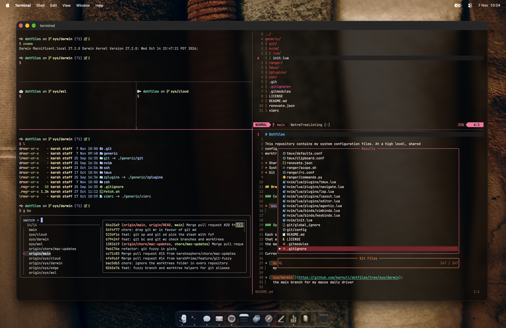

# Dotfiles

Karnull's terminal setup: zsh, tmux and Neovim, shared across a Mac, a home
server, a Raspberry Pi and a work machine. Anything every machine uses lives on
`main`; anything tied to one machine lives on that machine's `sys/` branch and
links back to the rest.




## What's in here

| Path        | What it is                                                                 |
|-------------|----------------------------------------------------------------------------|
| `zsh/`      | Shell config split by job, mostly lazy-loaded so the prompt comes up fast  |
| `zplugins/` | Vendored zsh plugins: defer, syntax highlighting and devedit               |
| `tmux/`     | tmux with window templates, an fzf session switcher and a ghostnet popup   |
| `nvim/`     | Neovim on the built-in `vim.pack`, with plugins loaded after startup       |
| `vimrc`     | Plain Vim, for when Neovim isn't around (claude ctrl+g in docker)          |
| `git/`      | Git defaults, fzf-powered aliases and a global ignore                      |


## How it fits together

Each machine checks out its `sys/` branch and puts `main` beside it as a
worktree at `generic/`. Files on a `sys/` branch are either specific to that
machine or symlinks into `generic/`, so overriding a shared file just means
swapping the symlink for a real one.

Shared changes made on a machine go on a `chore/<system>-updates` branch, such
as `chore/cloud-updates`, and come back to `main` as a pull request. Every other
machine picks them up on its next update.


## Systems

* [`sys/darwin`](https://github.com/karshosphere/dotfiles/tree/sys/darwin):
  the macOS daily driver
* [`sys/cloud`](https://github.com/karshosphere/dotfiles/tree/sys/cloud):
  a self-hosted Linux Mint server
* [`sys/edge`](https://github.com/karshosphere/dotfiles/tree/sys/edge):
  a Raspberry Pi edge server
* [`sys/wsl`](https://github.com/karshosphere/dotfiles/tree/sys/wsl):
  the work machine, on Windows Subsystem for Linux

Retired, but kept for reference:

* [`x/tools`](https://github.com/karshosphere/dotfiles/tree/x/tools):
  configs for tools no longer in use
* [`x/system`](https://github.com/karshosphere/dotfiles/tree/x/system):
  the old layout, one branch with a folder per system
* [`x/star`](https://github.com/karshosphere/dotfiles/tree/x/star):
  the original dotfiles, from the GNU/Linux daily-driver days


## Install

The installer is a shell script kept outside this repository:

```bash
wget -O - https://karsh.page/terminal | sh
```
